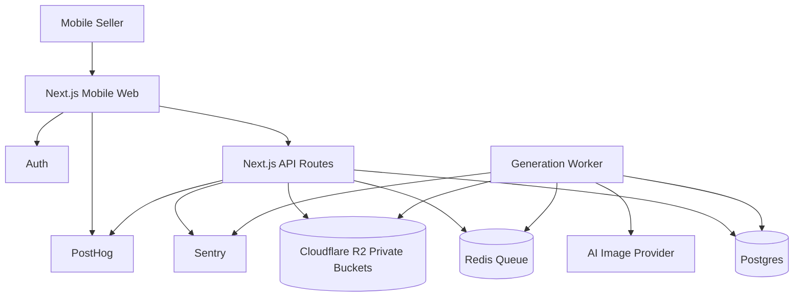
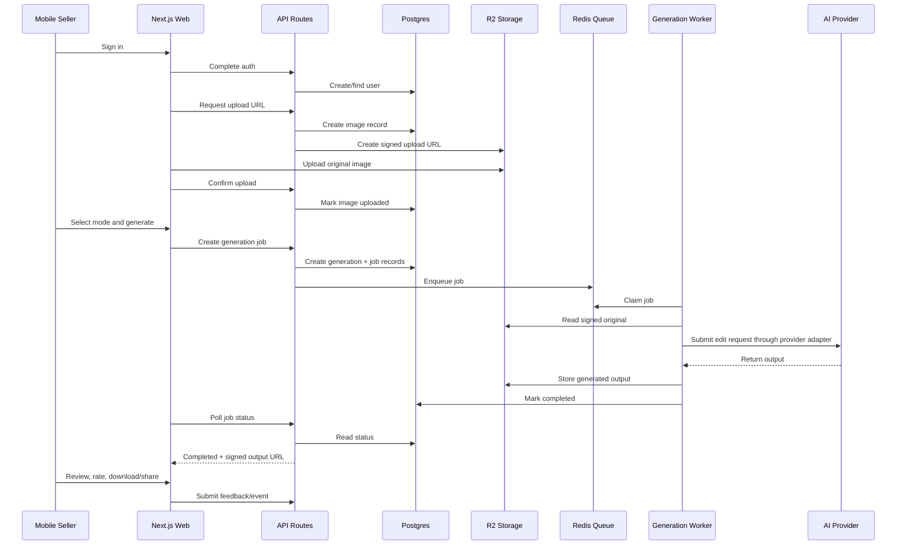
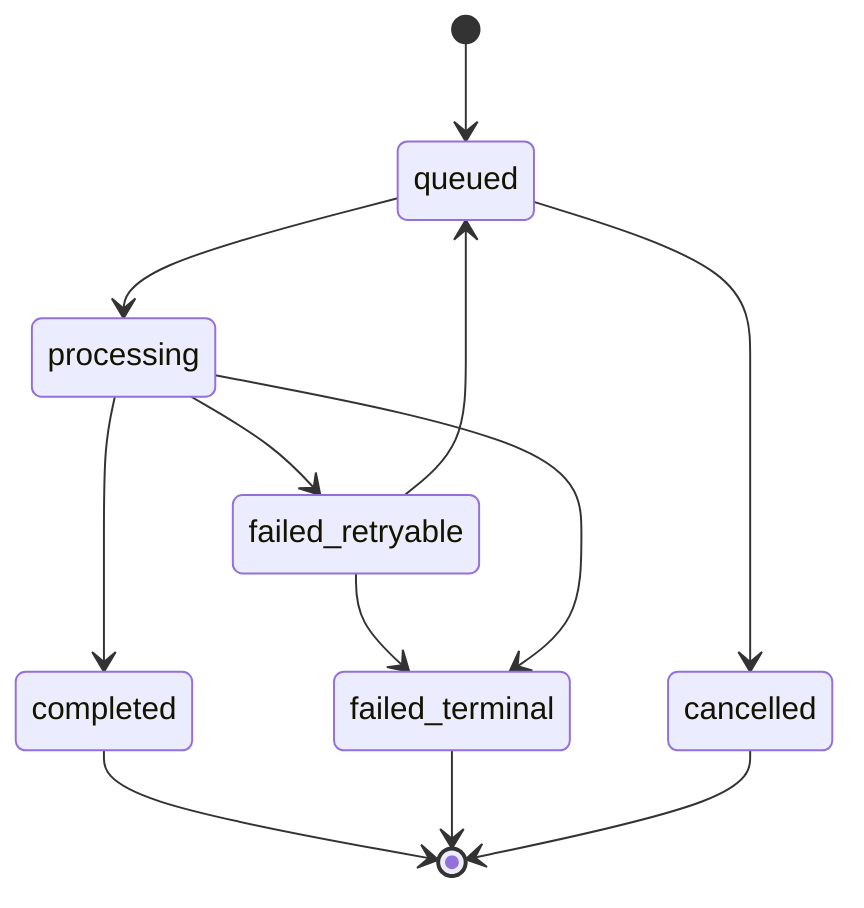

# Ornava System Design - Phase 1 v0.1

Status: Draft CTO review  
Scope: Phase 1 Core MVP  
Related: `phase1_prd_slice.md`, `prd.md`  
Primary goal: prove first trusted generation within 90 seconds on mobile web

## 1. CTO Summary

Phase 1 should not be built as the final Ornava platform. It should be built as a narrow, observable, production-grade activation loop: authenticate, upload, generate, review, capture feedback, and download/share. The engineering system should make the AI generation pipeline reliable and measurable while avoiding premature work on billing, catalogs, teams, public links, and advanced inventory.

The highest-risk path is not the UI. It is the asynchronous image-generation workflow: large uploads, private image access, queueing, provider latency, provider failures, output fidelity, retries, and cost control. The Phase 1 architecture should therefore be simple at the product edges and disciplined at the job-processing core.

## 2. Recommended Architecture

### CTO Recommendation

Use a modular monolith for the web/API surface plus a separate worker process for AI jobs.

- Web app: Next.js app for mobile UI and API routes.
- Worker: Node.js worker process running outside Vercel serverless, deployed on Railway/Fly/Render or similar.
- Database: Postgres, preferably Supabase for fast setup and row-level security.
- Object storage: Cloudflare R2 private buckets.
- Queue: Redis + BullMQ for generation jobs.
- Analytics: PostHog for event taxonomy and funnel analysis.
- Monitoring: Sentry for errors, provider failures, and worker exceptions.
- AI provider/model: one primary model for Phase 1, selected through an internal provider adapter and model registry. No product code should depend directly on a specific provider or model ID such as `openai/gpt-image-2/edit`.

This avoids over-splitting the backend while still respecting the operational reality that generation jobs are long-running and should not live inside serverless request handlers.

## 3. System Context



## 4. Core Flow



## 5. Component Responsibilities

### Mobile Web

- Owns onboarding, upload UI, mode selection, progress states, result comparison, feedback, download/share.
- Performs client-side file validation before upload.
- Calls API for signed upload/download URLs.
- Polls job status every 3 seconds in Phase 1.
- Tracks client events that do not require server truth, such as `signup_started`, `mode_selected`, and UI interactions.

### API Routes

- Own auth session validation.
- Create image records and signed upload URLs.
- Confirm upload completion.
- Create generation jobs idempotently.
- Read job status for polling.
- Return signed output URLs only to the owning user.
- Capture server-side events for upload, generation, and failures.

### Worker

- Pull jobs from Redis.
- Build server-side prompt from mode and prompt template version.
- Fetch original image from private storage.
- Resolve the configured model from the model registry.
- Call the provider adapter, not a hard-coded model endpoint.
- Store generated output in private storage.
- Update job/generation state transactionally.
- Retry only retryable failures.
- Emit timing, cost, provider, and failure metrics.

### Storage

- Use private buckets only.
- Suggested buckets:
  - `ornava-originals`
  - `ornava-generated`
  - `ornava-thumbnails`
- Object keys should include user ID and image/generation IDs, not raw filenames.
- Use signed URLs with short TTLs for upload and viewing.

### Analytics

- PostHog is the fastest fit for event funnels and product learning.
- Server-side event capture is required for source-of-truth events like `generation_completed`, `generation_failed`, and `upload_completed`.
- Client-side events are fine for UI path analysis.

## 5.1 Model Provider Strategy

### Principle

Ornava should be model-portable from day one. Image generation models will improve quickly on quality, latency, and cost. The codebase should allow a new provider or model to be added within hours, then promoted after an evaluation pass.

### Design Rule

No UI, API route, database business logic, or prompt-building code should reference a provider-specific model ID directly. Model IDs belong in configuration and the provider registry only.

### Provider Adapter Interface

Every image model adapter should expose the same internal contract:

```ts
type GenerationMode = "on_model" | "studio" | "close_up";

type ImageGenerationRequest = {
  generationId: string;
  userId: string;
  mode: GenerationMode;
  inputImage: {
    objectKey: string;
    signedUrl: string;
    mimeType: "image/jpeg" | "image/png" | "image/webp";
  };
  prompt: string;
  output: {
    aspectRatio: "1:1" | "4:5" | "9:16";
    format: "jpeg" | "png" | "webp";
    quality: "draft" | "standard" | "high";
  };
  metadata: {
    promptTemplateVersion: string;
    clientRequestId: string;
  };
};

type ImageGenerationResult = {
  provider: string;
  modelId: string;
  providerJobId?: string;
  outputUrl?: string;
  outputBytes?: Buffer;
  width?: number;
  height?: number;
  costEstimateMinor?: number;
  latencyMs: number;
  rawMetadata?: Record<string, unknown>;
};

interface ImageModelAdapter {
  submit(request: ImageGenerationRequest): Promise<ImageGenerationResult>;
  normalizeError(error: unknown): NormalizedGenerationError;
}
```

Adapters can internally use different protocols: REST, SDK, hosted queues, webhooks, polling, streaming, or direct binary uploads. The rest of Ornava should not care.

### Model Registry

Maintain a registry that describes capabilities and routing, for example:

```ts
const imageModelRegistry = {
  "ornava-default-v1": {
    provider: "fal",
    modelId: "openai/gpt-image-2/edit",
    adapter: "falImageEdit",
    enabled: true,
    capabilities: {
      imageToImage: true,
      supportsAspectRatio: ["1:1", "4:5", "9:16"],
      supportsMultipleInputs: false,
      supportsStreaming: false,
    },
    limits: {
      maxInputBytes: 4_000_000,
      maxLongEdgePx: 2048,
      timeoutMs: 120_000,
    },
    cost: {
      unit: "per_image",
      estimatedMinor: 0,
    },
  },
};
```

The app should reference `ornava-default-v1`, not the underlying provider model ID. A future cheaper or better model becomes `ornava-default-v2` after evaluation.

### Runtime Selection

Use layered model selection:

1. Global default: `IMAGE_MODEL_DEFAULT=ornava-default-v1`
2. Mode override: `IMAGE_MODEL_STUDIO`, `IMAGE_MODEL_ON_MODEL`, `IMAGE_MODEL_CLOSE_UP`
3. Beta cohort override for controlled tests
4. Manual admin override for debugging

This lets the team test a new model on 5% of beta users or only on `studio` mode without changing product code.

### Evaluation Gate

Do not promote a model because it is newer. Promote it when it beats the current default on:

- First-output usable rate.
- Design fidelity.
- Stone/detail preservation.
- Generation p95 latency.
- Cost per usable generation.
- Failure rate.
- Output consistency by mode.

For Phase 1, a simple offline eval set of 20-50 real jewelry images is enough. Keep the input, prompt template version, model ID, output, seller/human rating, latency, and cost estimate.

### Database Implication

Persist both stable routing name and concrete provider model:

- `model_route`: for example `ornava-default-v1`
- `provider`: for example `fal`
- `provider_model_id`: for example `openai/gpt-image-2/edit`
- `provider_job_id`
- `prompt_template_version`
- `adapter_version`

This gives model portability without losing auditability.

## 6. Data Model v0.1

### `users`

| Field | Notes |
| --- | --- |
| `id` | UUID primary key |
| `email` | Nullable if phone-first |
| `phone` | Nullable if Google-first |
| `name` | Optional |
| `created_at` | Timestamp |
| `last_seen_at` | Timestamp |
| `beta_cohort` | Optional string |

### `images`

| Field | Notes |
| --- | --- |
| `id` | UUID primary key |
| `user_id` | FK to users |
| `original_object_key` | R2 key |
| `thumbnail_object_key` | Optional |
| `status` | `created`, `uploaded`, `failed`, `deleted` |
| `file_type` | JPG/PNG |
| `file_size_bytes` | Integer |
| `width` / `height` | Optional but useful |
| `created_at` | Timestamp |

### `generations`

| Field | Notes |
| --- | --- |
| `id` | UUID primary key |
| `user_id` | FK to users |
| `image_id` | FK to images |
| `mode` | `on_model`, `studio`, `close_up` |
| `status` | `queued`, `processing`, `completed`, `failed`, `cancelled` |
| `output_object_key` | Nullable until complete |
| `model_route` | Stable Ornava route, for example `ornava-default-v1` |
| `prompt_template_version` | Required for debugging |
| `provider` | Provider identifier |
| `provider_model_id` | Concrete model used by the adapter |
| `provider_job_id` | Nullable |
| `adapter_version` | Internal adapter version |
| `attempt_count` | Integer |
| `failure_code` | Nullable |
| `failure_message_safe` | User-safe message |
| `generation_duration_ms` | Nullable |
| `estimated_cost_minor` | Cost tracking |
| `created_at` / `completed_at` | Timestamps |

### `generation_feedback`

| Field | Notes |
| --- | --- |
| `id` | UUID primary key |
| `user_id` | FK to users |
| `generation_id` | FK to generations |
| `rating` | `usable`, `not_usable` |
| `reason` | Required if not usable |
| `free_text` | Optional |
| `created_at` | Timestamp |

### `events`

Do not build a full analytics warehouse in Phase 1 unless PostHog is unavailable. If events are stored locally, use them as a thin audit buffer:

| Field | Notes |
| --- | --- |
| `id` | UUID primary key |
| `user_id` | Nullable |
| `event_name` | String |
| `properties` | JSONB |
| `created_at` | Timestamp |

## 7. API Surface v0.1

| Method | Endpoint | Purpose |
| --- | --- | --- |
| `POST` | `/api/uploads/init` | Create image record and return signed upload URL |
| `POST` | `/api/uploads/complete` | Confirm upload and mark image uploaded |
| `POST` | `/api/generations` | Create generation job for image + mode using configured model route |
| `GET` | `/api/generations/:id` | Return status, timings, safe errors, signed output URL if complete |
| `POST` | `/api/generations/:id/retry` | Retry failed or not usable generation |
| `POST` | `/api/generations/:id/feedback` | Submit usable/not usable feedback |
| `GET` | `/api/generations/:id/download` | Return short-lived signed download URL |
| `POST` | `/api/events` | Capture client event batch |

### API Rules

- Every endpoint must validate session ownership.
- Generation creation must be idempotent using a client request ID.
- API should never expose raw R2 public URLs.
- Error responses must use stable error codes and user-safe messages.
- Provider errors must be preserved internally but sanitized before user display.

## 8. Job State Machine



### Retry Policy

- Retry provider/network failures up to 2 automatic retries in Phase 1.
- Do not retry content-policy, invalid-image, unsupported-file, or auth/storage failures automatically.
- Manual user retry creates a new generation record linked to the prior generation.
- First failed beta generation should not consume credits.

## 9. Security And Privacy

### Minimum Requirements

- Private object storage only.
- Signed upload and download URLs with short TTLs.
- User-scoped database reads and writes.
- Row-level security if using Supabase.
- Never log full signed URLs.
- Never log raw prompt content if it includes user-identifying metadata.
- Strip EXIF metadata where practical before provider submission or before output download.
- Rate limit upload and generation endpoints per user and IP.
- Define deletion path for originals and outputs, even if manual in Phase 1.

### CTO Risk Note

Jewelry images can reveal inventory, pricing tier, design catalog, and supplier relationships. Treat them as sensitive business assets, not casual user uploads.

## 10. Observability

### Product Funnel

- `auth_completed` to `upload_completed`
- `upload_completed` to `generation_requested`
- `generation_requested` to `result_viewed`
- `result_viewed` to `feedback_submitted`
- `result_viewed` to `download_clicked` or `share_clicked`

### Operational Metrics

- Generation p50, p90, p95 duration.
- Queue wait p50, p90, p95.
- Provider latency and error rate.
- Upload failure rate by reason.
- Retry rate by mode.
- Cost per completed generation.
- Cost per usable generation.
- Not usable reason distribution.

### Alerts

- Generation failure rate > 10% over 30 minutes.
- Provider timeout spike.
- Queue depth above configured threshold.
- Worker has no successful jobs for 10 minutes while queue is non-empty.
- R2 upload or signed URL failures.
- Sentry error spike on onboarding or generation endpoints.

## 11. CTO Review Of Current PRD Tech Choices

### Keep

- Next.js mobile web is the right Phase 1 surface.
- Cloudflare R2 is a good fit for private, cost-controlled image storage.
- Redis + BullMQ is appropriate if there is a separate long-running worker.
- Postgres is the correct source of truth.
- PostHog or Mixpanel from day one is necessary, not optional.

### Change Or Clarify

- Avoid building both `apps/web` and `apps/api` as separate services unless there is a clear need. A Next.js app plus a separate worker is enough for Phase 1.
- Do not run AI generation in Vercel API routes. Use a worker process.
- Choose one auth path for beta if dual Gmail plus OTP slows launch. Phone-first is strategically aligned, but OTP integration can add friction and vendor complexity.
- Defer Razorpay entirely from Phase 1 unless credits are needed only as a visible placeholder.
- Validate the exact first default model availability, cost, latency, and commercial terms before build lock, but keep provider/model selection behind the registry so it can change quickly.
- SSIM alone is not a sufficient fidelity check for jewelry. Use seller feedback and a fidelity rubric first, then automate later.

## 12. Build Plan

### Milestone 1: Skeleton And Auth

- Next.js app shell.
- Mobile onboarding route.
- Auth path selected and working.
- Postgres schema migration.
- PostHog and Sentry initialized.

### Milestone 2: Upload Pipeline

- Signed upload URL endpoint.
- R2 private bucket setup.
- Client file validation.
- Upload complete confirmation.
- Thumbnail placeholder or generation.

### Milestone 3: Generation Pipeline

- Generation API.
- Redis queue.
- Worker service.
- Provider adapter.
- Job state transitions.
- Polling endpoint.

### Milestone 4: Results And Feedback

- Original/generated comparison.
- Usable/not usable feedback.
- Retry flow.
- Download/share handoff.
- Activation funnel dashboard.

### Milestone 5: Beta Hardening

- Error taxonomy.
- Rate limits.
- Cost tracking.
- Worker alerts.
- Internal admin query or dashboard for failed jobs.

## 13. Non-Negotiable Acceptance Criteria

- A new beta user can complete first generation on mobile.
- No raw original or generated image is publicly accessible without a signed URL.
- Every generation has a traceable state transition history or enough logs to reconstruct it.
- Every failed generation has a stable failure code.
- The team can answer daily: activation rate, generation success rate, first-output usable rate, p95 generation time, and cost per usable generation.
- A provider outage does not corrupt data or leave jobs permanently stuck in `processing`.

## 14. Top CTO Risks

| Risk | Why It Matters | Mitigation |
| --- | --- | --- |
| Provider latency breaks 90-second activation | The core promise fails before user sees value | Measure provider latency before beta; show queue/ETA; use async recovery |
| AI changes jewelry details | Trust collapses immediately | Capture not-usable reasons; create fidelity rubric; compare modes by usable rate |
| Worker/serverless mismatch | Long jobs fail unpredictably | Run a dedicated worker outside serverless |
| Uploads through app server | Slow and expensive | Use direct-to-R2 signed uploads |
| Missing event discipline | Cannot learn from beta | Implement event taxonomy before first beta user |
| Overbuilt billing/catalog systems | Slows proof of value | Defer Phase 4/5 surfaces |
| Weak image privacy | Sellers may upload sensitive inventory | Private buckets, signed URLs, user-scoped access, EXIF stripping |
| No cost visibility | Unit economics unknown | Track estimated cost per completed and usable generation |

## 15. Decision Log

| Decision | Recommendation | Rationale |
| --- | --- | --- |
| Backend shape | Next.js API + separate worker | Keeps Phase 1 simple while supporting async jobs |
| Queue | Redis + BullMQ | Mature Node ecosystem and retry support |
| Storage | Cloudflare R2 private buckets | Cost-effective image storage and signed URL flow |
| Auth | One reliable beta path first | Reduces launch risk |
| Analytics | PostHog from day one | Funnel learning is the product goal |
| Billing | Defer | Not needed to validate first trusted generation |
| Fidelity automation | Defer hard automation; collect feedback first | Need real failure taxonomy before building scoring |
| Model strategy | Provider adapter + model registry | Lets Ornava adopt better/cheaper models without rewriting product code |

## 16. Open Technical Questions

- Which auth path is the actual Phase 1 beta default: phone OTP, Google, or magic link?
- What model should be configured as `ornava-default-v1` after validating availability, latency, rights, fidelity, and cost?
- What is the maximum accepted image size after client compression?
- Should originals be retained for beta, and for how long?
- What exact output dimensions count as WhatsApp-ready?
- Is native share-sheet enough for Phase 1, or is a dedicated WhatsApp deep link required?
- What internal admin view is needed to debug user failures during beta?
