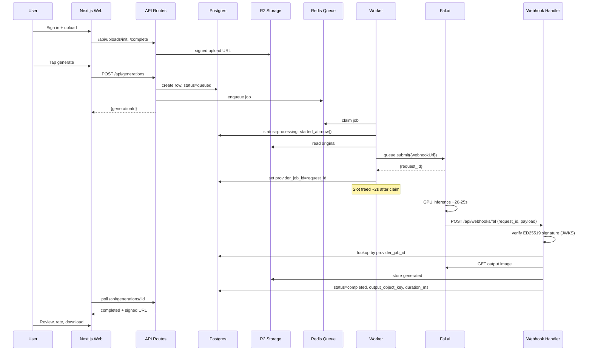
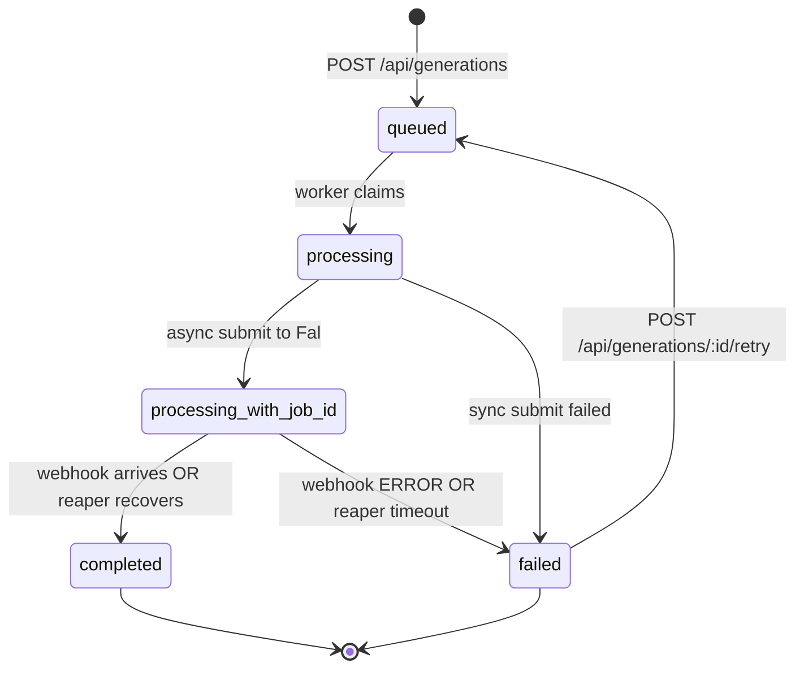

# Ornava System Design - Phase 1 v0.2

Status: Active — async architecture live  
Date: 2026-05-13  
Scope: Phase 1 Core MVP  
Supersedes: `system_design_phase1_v0_1.md`  
Related: `phase1_prd_slice.md`, `adr_001_model_portability.md`, `adr_002_async_webhook_architecture.md`

## Change Log v0.1 → v0.2

| Area | v0.1 | v0.2 |
| --- | --- | --- |
| Worker concurrency | 2 parallel jobs | 10 per worker × 2 replicas = **20 parallel slots** |
| Provider call pattern | Synchronous `fal.subscribe()` — worker blocks 25s per job | Async `fal.queue.submit()` with webhook — worker releases slot in ~2s |
| State machine | `queued → processing → completed` | `queued → processing (submitted) → completed` via webhook |
| Completion path | Worker downloads output and marks complete | Webhook endpoint downloads and marks complete |
| Stuck job recovery | None | Reaper polls Fal every 30s for jobs >60s old |
| Admin surface | None | `/admin` desktop dashboard + `/admin/generations` debug view |
| Postgres pool | Default (10) | 15 per worker — 30 total |
| Throughput (theoretical) | ~5 jobs/min | ~600 submissions/min |
| Capacity at 90s SLA | 50 concurrent users | 500+ concurrent users |

---

## 1. CTO Summary

Phase 1 v0.2 is running a narrow activation loop in production on EC2 with async job submission to Fal.ai, webhook-driven completion, and an admin dashboard for beta operations. The design goal remains the same: prove the first trusted generation in <90s on mobile web. The architectural changes in v0.2 are about removing the worker-thread-per-job bottleneck that was limiting scale, not changing product scope.

The key insight behind v0.2: **our workers were sleeping**. Each job held a BullMQ slot for ~25s, but spent ~92% of that time idle, awaiting Fal.ai's GPU. Moving to async submission + webhook completion collapses that to ~2s of worker time per job. Same compute, 12× throughput.

## 2. Architecture v0.2

### Stack

- **Web app**: Next.js 15 (App Router) on EC2 t3.small
- **Worker**: Node.js + BullMQ, 2 replicas × concurrency 10 on same EC2
- **Database**: Postgres on Supabase (pooler mode)
- **Object storage**: Cloudflare R2 private buckets (originals, generated, thumbnails)
- **Queue**: Upstash Redis with TLS
- **Image provider**: Fal.ai via model registry (`ornava-default-v1`)
- **Proxy**: nginx in front for HTTPS / routing
- **CI/CD**: GitHub Actions → EC2 docker compose

### System Context (v0.2)

```mermaid
flowchart TD
  U[Mobile Seller] --> W[Next.js Mobile Web]
  W --> A[NextAuth Session]
  W --> API[Next.js API Routes]
  API --> DB[(Postgres Supabase)]
  API --> R2O[(R2 Originals)]
  API --> Q[(Upstash Redis Queue)]

  subgraph WorkerPool[Worker Pool - 2 replicas x 10 concurrency]
    W1[worker-1]
    W2[worker-2]
    R[Reaper - 30s interval]
  end

  WorkerPool --> Q
  WorkerPool --> DB
  WorkerPool --> R2O
  WorkerPool -- fal.queue.submit --> Fal[Fal.ai Queue]

  Fal -- webhook POST --> WH[/api/webhooks/fal]
  WH --> DB
  WH --> R2G[(R2 Generated)]

  R -- poll status when stuck --> Fal

  Admin[Admin Dashboard /admin] --> DB
  Admin --> R2O
  Admin --> R2G
```

## 3. Core Flow v0.2 (Async Webhook Path)



## 4. Component Responsibilities v0.2

### Worker (changed)

**Old v0.1 behavior:**
- Claim job from queue
- Block on `fal.subscribe()` for 25s
- Download output, write to R2, mark complete

**New v0.2 behavior (when webhook mode is active):**
- Claim job from queue (concurrency = 10)
- Mark processing, read original from R2
- Call `adapter.submitAsync({ webhookUrl })`
- Store `provider_job_id` in DB
- **Return** — slot freed, next job starts

Fallback: if `WEBHOOK_BASE_URL` is unset (dev without ngrok), worker falls back to sync `fal.subscribe()` path. Feature flag is implicit via env var presence. Note: `FAL_WEBHOOK_SECRET` is **not** required — Fal.ai signs webhooks with their own ED25519 keys published via JWKS, not a shared secret.

### Webhook Handler (new)

`POST /api/webhooks/fal` — public endpoint that receives Fal completion notifications.

Responsibilities:
- Verify signature using Fal's ED25519 + JWKS scheme — fetch public keys from `https://rest.fal.ai/.well-known/jwks.json`, cache 24h, check timestamp freshness (±5 min), verify signature against every key until one matches
- Look up generation by `provider_job_id`
- Idempotent — skip if already completed or failed (status guard on UPDATE)
- Download output image from Fal's CDN URL
- Upload to R2 using the same key pattern as the old worker path
- Mark generation completed with duration calculated from `started_at`
- Handle error status — mark failed with `provider_unavailable`
- Return 200 even on internal errors to prevent Fal retry storms

Always runs on `runtime = "nodejs"` (not Edge) because we use Node `crypto` for ED25519 verification and need raw body bytes before JSON parsing (signature covers exact bytes Fal sent).

### Reaper (new)

Runs inside the worker process on a 30-second `setInterval`.

Responsibilities:
- Find generations stuck in `processing` status with `provider_job_id` set and `started_at` older than 60s
- For each, call `fal.queue.status(request_id)` to check real state
- If Fal says `COMPLETED`, fetch result and complete the generation (webhook got lost)
- If Fal still says `IN_PROGRESS` and job is >5 minutes old, mark it failed with `provider_timeout`
- If Fal is unreachable and job is >5 minutes old, mark failed with `provider_unavailable`

Only runs if `WEBHOOK_BASE_URL` is set (async mode active). Logs each recovery cycle.

### Admin Dashboard (new)

Protected by `isAdminEmail()` check against `ADMIN_EMAILS` env var.

`/admin` — desktop dashboard (not `PhoneShell`):
- KPI cards: total users, new today, total generations, success rate, usable rate, credits burned today, credits remaining
- Generation health: p50 / p95 latency, completed / failed counts
- Feedback breakdown: rating + reason + count
- Beta users table: email, credits, generations, usable count, last active, joined

`/admin/generations` — debug view:
- Grid of recent generations showing original + generated thumbnails
- Status, mode, user email, duration, model route, feedback
- Error code and safe message for failed jobs
- Signed URLs expire in 15 minutes

## 5. State Machine v0.2



`processing_with_job_id` is not a separate DB status — it's the same `processing` row but with `provider_job_id` populated. This keeps the DB enum stable while allowing richer behavior in code.

## 6. Scale Math v0.2

### Per-job breakdown (measured)

| Stage | Time |
| --- | --- |
| R2 read (original) | ~200ms |
| Upload to Fal | ~1-2s |
| Worker returns (async mode) | **~2s total** |
| Fal GPU inference (not blocking worker) | ~20-25s |
| Webhook: download + R2 write + DB update | ~1-2s |

### Throughput at 20 parallel slots

- Sync mode (v0.1): 20 slots × (60s / 25s per job) = 48 jobs/min
- Async mode (v0.2): 20 slots × (60s / 2s per job) = **600 submissions/min**

### Capacity under 90s SLA

Budget per user: 90s - 25s (Fal compute) = 65s max queue + submit time

- 50 users: all submit in <5s with 20 slots. Everyone's result lands in ~27s. **Well under 90s.**
- 500 users: submit in ~50s. Last user's result ~75s. **Still under 90s.**
- 1000 users: submit in ~100s. Last user hits 125s. **Exceeds 90s without scaling.**

Beyond 500 concurrent, next bottleneck becomes Fal.ai rate limits and GPU capacity, not our infra.

## 7. Data Model Changes

No schema migration needed for v0.2 — existing `generations` table already had `provider_job_id` column.

Enum values unchanged: `queued`, `processing`, `completed`, `failed`, `cancelled`.

### New DB helpers

**Worker** (`apps/worker/src/db.ts`):
- `markGenerationSubmittedAsync()` — sets provider + provider_job_id after async submission

**Web** (`apps/web/src/lib/db.ts`):
- `getGenerationByProviderJobId()` — webhook lookup
- `markGenerationCompletedFromWebhook()` — idempotent UPDATE with status='processing' guard
- `markGenerationFailedFromWebhook()` — same idempotent pattern

## 8. API Surface Additions

| Method | Endpoint | Purpose |
| --- | --- | --- |
| `POST` | `/api/webhooks/fal` | Fal.ai completion webhook (new) |
| `GET` | `/api/admin/stats` | Admin dashboard metrics (new, not yet wired from client) |
| `GET` | `/api/admin/generations` | Admin generations listing with signed URLs (new) |

Protected endpoints (new):
- `/admin` and all `/admin/*` — require session + `isAdminEmail()` check

## 9. Environment Variables Added

```bash
# Webhook architecture
WEBHOOK_BASE_URL=https://your-domain.com   # Where Fal sends completions.
                                           # Local: use ngrok → https://xxx.ngrok.io
# Note: Fal signs webhooks with their own ED25519 keys (public keys from JWKS
# at https://rest.fal.ai/.well-known/jwks.json). No shared secret from us.

# Admin access
ADMIN_EMAILS=email1@example.com,email2@example.com  # Comma-separated list
```

If `WEBHOOK_BASE_URL` is missing, worker silently falls back to sync mode — no breaking change.

## 10. Infrastructure Changes

### docker-compose.production.yml

Split single `worker` service into `worker-1` and `worker-2` (explicit replicas rather than `deploy.replicas` which is finicky outside swarm mode). Both mount the same image and env, but run as independent containers with separate BullMQ worker identities.

```yaml
worker-1:
  container_name: ornava-worker-1
  # concurrency=10
worker-2:
  container_name: ornava-worker-2
  # concurrency=10
```

Web `depends_on` updated to reference both workers.

### BullMQ tuning

- `concurrency: 10` per worker
- `lockDuration: 90s` (default 30s is too short for Fal jobs)
- `lockRenewTime: 30s`
- `stalledInterval: 30s`, `maxStalledCount: 1`

### Postgres pool

`max: 15` per worker = 30 total connections (well under Supabase Pro's 500).

## 11. Failure Modes and Recovery

| Failure | Detection | Recovery |
| --- | --- | --- |
| Worker crashes mid-submission | BullMQ stalled job detection (30s) | Redelivered to another worker |
| Webhook never arrives (network blip) | Reaper detects job >60s old with `provider_job_id` | Polls Fal, completes if COMPLETED |
| Webhook arrives twice (Fal retry) | Status guard on UPDATE | Second write is a no-op |
| Fal.ai down | All submissions fail fast | Adapter normalizes 5xx to retryable `provider_unavailable` |
| Invalid signature or stale timestamp | ED25519 verification against JWKS fails, or timestamp outside ±5min window | Return 401, log reason code |
| R2 write fails after Fal completes | Webhook catches, marks generation failed | User sees failed state, can retry |
| Generation exceeds 5 minutes | Reaper force-fails | User sees failure, can retry (new generation) |

## 12. Security v0.2 (additions)

- **Webhook signature verification**: all inbound Fal webhooks verified using Fal's ED25519 + JWKS scheme. Public keys are fetched from `https://rest.fal.ai/.well-known/jwks.json` and cached for 24h. Timestamp must be within ±5 min of now to prevent replay attacks. Uses Node's built-in `crypto` module — no new dependencies.
- **Admin route protection**: enforced at layout level in `app/admin/layout.tsx` — any non-admin email hits `notFound()`, not a redirect (prevents disclosure that the route exists)
- **Signed URLs in admin**: all admin image previews use short-lived signed URLs (15 min), same as user-facing result page

## 13. Observability v0.2

### New events

- `generation_completed` with `source: "webhook"` or `source: "reaper"` to distinguish recovery paths
- `generation_failed` with webhook context when Fal reports error
- Reaper logs stuck-job cycles with counts

### Admin dashboard metrics (from DB)

All metrics live-queried from Postgres on each page load (`dynamic = "force-dynamic"`):

- Total beta users, new today
- Total generations, success rate, usable rate
- Credits burned today, credits remaining (sum across users)
- p50 / p95 generation latency (across completed + failed)
- Feedback breakdown (rating + reason)
- Per-user: email, credits, generation count, usable count, last active, joined

### Alerts (still TODO — same as v0.1)

Not yet implemented. Planned:
- Generation failure rate > 10% over 30 min
- Queue depth > 50
- Worker has no successful jobs for 10 min while queue is non-empty
- Webhook signature failures > 5 in 5 min (indicates attacker or misconfiguration)

## 14. What Changed That Did NOT

- Model registry and provider adapter contracts — still as per ADR-001
- Upload pipeline — unchanged
- Auth flow — unchanged
- Result comparison slider — unchanged (added in v0.1 endgame)
- Feedback capture — unchanged
- Download + WhatsApp share — unchanged
- All client-facing screens — unchanged

The v0.2 changes are **entirely server-side**. Users see faster generations but no new UI.

## 15. Non-Negotiable Acceptance Criteria v0.2

All v0.1 criteria still apply, plus:

- A worker crash does not lose in-flight generations (Fal continues, reaper recovers)
- A duplicate webhook does not double-complete a generation
- A generation stuck in `processing` for >5 min automatically fails
- An HMAC-invalid webhook is rejected and logged
- Admin dashboard loads live data — never cached

## 16. Open Technical Questions v0.2

- Should we replace the 3-second client-side polling with SSE / WebSocket now that the completion path is event-driven on the server?
- At what user count do we need to migrate from polling-based reaper to a DB trigger or pub/sub notification?
- Should we add a circuit breaker around Fal.ai submissions so we fail fast during provider outages?
- Is there value in multi-provider (Replicate, Stability) fallback before 500 users?
- Do we need per-user rate limiting yet, or is credit system enough of a throttle?
